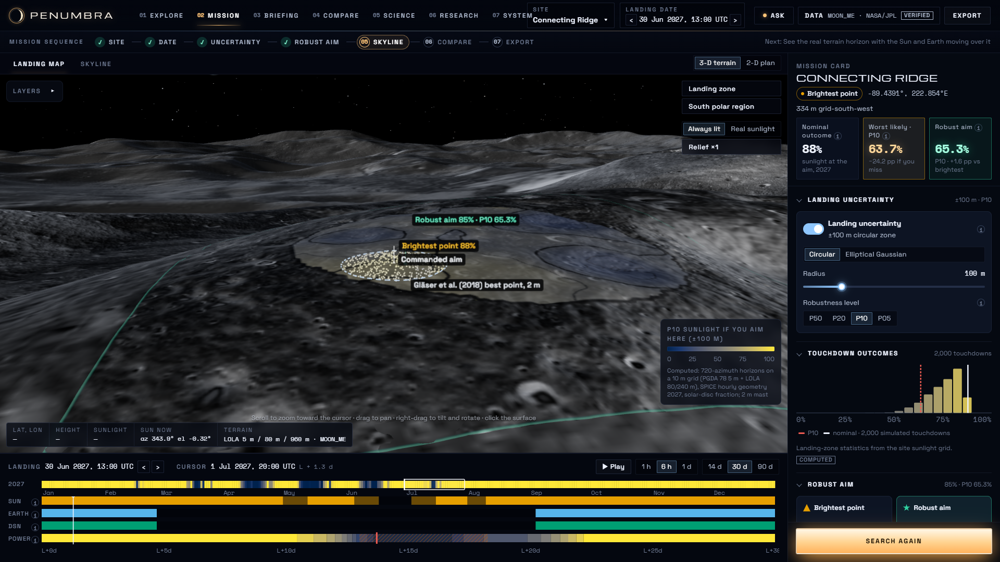
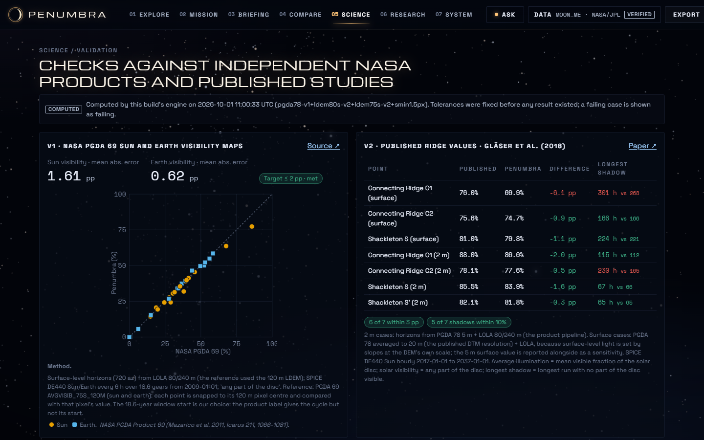

# Penumbra


**Know your odds of light before you land.** Penumbra is a lunar landing-planning tool for the Moon's south pole (NASA Space Apps 2026, Challenge 4).

It shows how much sunlight, Earth visibility and Deep Space Network contact a landing would get. It looks not only at the point you aim for, but at everywhere the lander might actually touch down.

Its built-in assistant, **Armstrong**, explains every step in plain language. Penumbra suits:

- mission planners and payload teams;
- students and members of the public;
- judges.

> Do not plan only for where you aim. Plan for where you may actually land.
> The brightest landing point is not necessarily the safest point to aim for.

| Planner: brightest point vs robust aim | Science & validation |
|---|---|
|  |  |

**Contents:**

- [Get started](#get-started)
- [Find your way around](#find-your-way-around)
- [Plan a landing in five minutes](#plan-a-landing-in-five-minutes)
- [The sections](#the-sections)
- [Reading the results](#reading-the-results)
- [Ask Armstrong](#ask-armstrong)
- [Working offline](#working-offline)
- [Troubleshooting](#troubleshooting)
- [More documentation](#more-documentation)

---

## Get started

### What you need

- **Python 3.12** and **Node.js 20 or newer**.
- **About 6 GB of free disk space**, mostly for the NASA/JPL data.
- **An internet connection for the first setup.** After that, Penumbra can run offline.

### First-time setup

Run these from the repository folder:

```bash
# 1. Python environment
python -m venv .venv
.venv\Scripts\activate                 # macOS/Linux: source .venv/bin/activate
pip install -r backend/requirements.txt

# 2. Frontend
npm ci

# 3. Data (not stored in the repository; see DATA_DOWNLOAD_MANUAL.md)
python tasks.py data                   # downloads and checks the NASA/JPL files (3.3 GB)
python tasks.py precompute             # terrain horizon grids for the 5 sites (a few minutes, up to ~30 on a laptop)
python tasks.py imagery                # globe imagery tiles (optional but recommended; a long download)

# 4. Check and start
python tasks.py doctor                 # every required line should say OK
python tasks.py dev                    # then open http://127.0.0.1:4173 in your browser
```

If PowerShell refuses to run the activation script, run `.venv\Scripts\Activate.ps1` instead.

If a data download is interrupted, run the same command again: it carries on where it stopped. The [data download manual](DATA_DOWNLOAD_MANUAL.md) explains every option.

### Every time after that

```bash
.venv\Scripts\activate                 # macOS/Linux: source .venv/bin/activate
python tasks.py dev                    # open http://127.0.0.1:4173; stop with Ctrl+C
```

---

## Find your way around

The header is the same on every screen:

| Part | What it does |
|---|---|
| **01 Explore … 07 System** | The seven sections of the app (on narrow screens, a menu button lists them). |
| **Site** and **Landing date** | Shown on Mission, Briefing and Compare. **‹** and **›** move the landing date by one day. |
| **Computing** | Appears while the server is working on your request. |
| **Data** | Opens *Data and provenance*: every dataset, file, version and checksum behind the numbers. |
| **Export** | Opens the decision summary for your current plan (**Copy JSON** or **Download JSON**). |
| **Ask** | Opens Armstrong, the assistant (see [Ask Armstrong](#ask-armstrong)). |

The address bar keeps your place, so you can bookmark or share a view:

| Link | Opens |
|---|---|
| `http://127.0.0.1:4173/?mode=planner&site=cr1` | Mission planner at Connecting Ridge |
| `?mode=simple&site=shk` | Briefing for Shackleton rim |
| `?mode=planner&site=mal&view=sky` | Mission planner at Malapert, on the Skyline view |
| `?mode=planner&site=cr1&landing=4320` | Connecting Ridge with a landing on 30 Jun 2027 |
| `?mode=compare`, `?mode=science`, `?mode=report`, `?mode=about` | Compare, Science, Research, System |

**Notes on the links:**

- `landing` is the hour of 2027 when the lander touches down (0 = 1 Jan 00:00 UTC).
- Site codes:

  | Code | Site |
  |---|---|
  | `cr1` | Connecting Ridge |
  | `shk` | Shackleton rim |
  | `mal` | Malapert |
  | `mou` | Mons Mouton / Leibnitz β |
  | `nob` | Nobile rim 1 |

---

## Plan a landing in five minutes

1. Open **02 Mission**. The **Mission sequence** bar lists seven steps, and **Next:** tells you what to do next.
2. **Site:** pick a site in the header.
3. **Date:** click a day on the calendar strip at the bottom. Brighter days mean more sunlight.
4. **Uncertainty:** in *Landing uncertainty*, set how far from the target the lander might land (for example, a 100 m radius). Then choose how careful to be (**P10 · Conservative** is a good default).
5. **Robust aim:** click **Find robust aim**. The map shows the **brightest point** and the **robust aim**, which is the target that stays in sunlight even when the landing is off-target.
6. **Skyline:** open the **Skyline** tab to see the real terrain horizon, with the Sun and Earth moving over it.
7. **Compare**, then **Export**: rank this site against the others, then save the decision summary.

If you'd rather be guided, click **Ask** and then **Walk me through it**.

---

## The sections

### 01 Explore: the 3-D Moon

When the app starts, an introduction appears. It fades away as soon as you start exploring; you can also close it with **✕**.

**Moving around the globe:**

- **Drag** to spin the Moon. Release while moving to let it roll.
- **Scroll** to zoom.
- **Right-drag** to tilt.
- **Click** anywhere to inspect that place.

**Quick views:** **Nearside (from Earth)**, **Earth in view**, **North Pole** and **South Pole**.

**Lighting:**

- **Always lit** shows every side of the Moon in soft light, so you can explore anywhere.
- **Real sunlight** lights the Moon from the Sun's true direction at the selected time, with day, night and long polar shadows.

**Earth size:** **Earth ×4** enlarges Earth so it is easy to see; **True scale** shows its real apparent size. Either way, it is drawn in its true direction and phase.

**Time bar:** **▶** plays 2027 forward at **1 h/s**, **6 h/s** or **1 d/s**. You can also drag the slider to any moment.

**Clicking a place** opens an information card. It shows:

- the place's height and slope;
- how often the Sun and Earth are above its horizon in 2027;
- the brightest spot nearby, and the nearest Penumbra site;
- *Where should you aim?*: the brightest point next to the safest aim. Click anywhere on the coloured area to move your aim.

**Plan a landing** opens the quick landing planner:

1. **Where?** Choose one of the five sites, and the camera flies down to its real terrain.
2. **When?** Pick a landing day on the year strip (brighter days mean more sunlight), or step with **‹ ›**.
3. Read the results: **Sunlight**, **Longest night**, **Earth in view** and **Battery lasts**.

From there, **Advanced planner** opens the full Mission page, and **Export** saves the plan.

### 02 Mission: the full planner

**Mission sequence.** Seven steps run across the top: **Site**, **Date**, **Uncertainty**, **Robust aim**, **Skyline**, **Compare** and **Export**.

- Finished steps are ticked, and the next one is highlighted.
- Click any step to jump to it.

**Landing map** tab:

- **Map mode** switches between a **2-D plan** and **3-D terrain**.
- **Click inside the dashed box** to set the commanded aim: the point you tell the lander to aim for.
- The **Layers** panel turns these on and off:
  - **Heatmap:** sunlight as a % of 2027 (**Nominal**), or the robust score (**Robust**);
  - **Landing uncertainty zone**;
  - **Possible touchdowns:** the simulated landings;
  - **Shaded relief:** lit by the Sun;
  - **Slope > 5°**;
  - **Known points:** published reference points from Gläser et al. 2018.
- **3-D terrain:**
  - **Landing zone** shows the site close up; **South polar region** shows the wider area around it;
  - **Always lit** or **Real sunlight** with real shadows;
  - adjustable vertical exaggeration.

**Skyline** tab:

- **Sky view:** a **2-D panorama** of the horizon, or a **3-D sky dome**.
- Vertical exaggeration **×1**, **×5** or **×10**.
- Drag to look around, and scroll to zoom.
- The Sun and Earth follow the calendar's time cursor.

**Landing uncertainty** panel:

- **Uncertainty model:**
  - **Circular** (set a **Radius**);
  - **Elliptical Gaussian** (set **σ east**, **σ north**, **Rotation** and the **Confidence ellipse**).
- **Robustness level:**
  - **P50 · Typical**;
  - **P20 · Cautious**;
  - **P10 · Conservative**;
  - **P05 · Highly conservative**.

  The more conservative the level, the more of the bad landings the plan allows for.
- **Find robust aim** searches every possible aim point and picks the one with the best result at your robustness level. The **Touchdown outcomes** chart shows the spread of results across the simulated landings.

**Mission calendar** (bottom of the screen):

- Rows for the Sun, Earth, DSN and power over the mission.
- Pick the landing day on the strip, or step with **‹ ›**.
- **Mission horizon** sets the length shown: **14 d**, **30 d** or **90 d**.
- Play the mission at **1 h**, **6 h** or **1 d** per second.
- The cursor marks the moment shown on the map and skyline.

**Mission card:**

- **Results:** the **Nominal** and **Conservative** outcomes, **Sunlight**, **Earth visibility**, **DSN geometric opportunity**, **Major darkness period** and the **Energy endurance estimate**.
- **Vehicle & settings:**
  - **Vehicle scenario:** a VIPER preset built from NASA figures, plus labelled assumption presets.
  - **Power scenario:** edit battery capacity, baseline load, hibernation load, usable reserve and panel heading. **Restore preset values** undoes your edits.
  - **Earth visibility margin**.
  - **DSN elevation mask:** **6° downlink** or **10.1° uplink**.
  - **Mast height:** the stored grids are for a 2 m mast.
  - **Exact coordinates** in the MOON_ME frame.

### 03 Briefing: the plain-language summary

This page has one card for the chosen site and date: *A rover landing here on this date has…*

- a rating for its initial sunlight and for its landing-position risk;
- the sunlight it gets in 9 of 10 likely touchdowns;
- how often Earth is visible;
- the longest darkness in the first days.

Choose the landing accuracy with **Precise ±50 m**, **Typical ±100 m** or **Loose ±400 m**. A compact map shows the landing zone.

### 04 Compare: rank the sites

*Which site keeps the lander in sunlight, wherever it actually lands?*

- **Choosing sites:** click the site chips to choose two or more sites. **All sites** compares all five; **Back to three** returns to three.
- **Which date it uses:** your current landing date and mission length (the **Mission horizon** setting on the Mission calendar).
- **How sites are ranked:** Penumbra finds each site's robust aim, simulates the touchdowns, and ranks the sites by sunlight at your robustness level.
- **Columns:**
  - **Nominal (brightest point)**;
  - **P50**, **P20** and **P10 at robust aim**;
  - **Earth visibility**;
  - **DSN geometric opportunity**;
  - **Longest darkness** in the mission window.

### 05 Science: validation

This page shows how Penumbra's results compare with independent references, using tolerances fixed in advance:

- **V1:** NASA's PGDA 69 sunlight maps;
- **V2:** the published values of Gläser et al. (2018);
- **V4:** JPL Horizons.

It also shows the latest automated test report.

### 06 Research: the research report

The full report: the problem, the gaps, the method, the findings and the references.

- Figures are computed live from the same engine.
- A contents list beside the text follows your scrolling.

### 07 System: how Penumbra works

This page covers the data pipeline, the datasets, the validation and the limits, with links to each section of the app.

---

## Reading the results

| Term | Meaning |
|---|---|
| **Sunlight** | Share of the time the Sun is above the local terrain horizon. A partly hidden Sun counts in part. |
| **Nominal outcome** | Sunlight if the lander touches down exactly on the aim point. |
| **P50 / P20 / P10 / P05** | Sunlight that 50%, 80%, 90% or 95% of the simulated touchdowns reach or beat. For example, **P10** is *planning for a bad day*: 9 of 10 likely landings do at least this well. |
| **Conservative outcome** | The result at your chosen robustness level (P10 by default). |
| **Brightest point** | The sunniest spot if you could land exactly on it. |
| **Robust aim** | The aim point with the best result at your robustness level, allowing for the landing error. It is often not the brightest point. |
| **Landing uncertainty zone** | Where the lander may actually come down: 2,000 simulated touchdowns drawn from your uncertainty model. |
| **Earth visibility** | Share of the time Earth is above the horizon by your safety margin, so direct-to-Earth radio is possible. |
| **DSN geometric opportunity** | Times when a Deep Space Network station (Goldstone, Madrid or Canberra) sees the Moon above its elevation mask *and* Earth is visible from the site. This is geometry only, not scheduled antenna time. |
| **Major darkness period** | The longest stretch without sunlight in the mission window. |
| **Energy endurance estimate** | How long the vehicle's battery lasts under the chosen power scenario. |

---

## Ask Armstrong

Click **Ask** in the header to open **Armstrong**. It answers in up to three ways:

- **Built-in guide.** Always available, free and offline, with no AI involved. It covers walkthroughs, explanations using your numbers, *What's this?*, help choosing a site and date, and changes made on request.
- **Space assistant** (optional). A free hosted AI model answers general space questions the guide doesn't recognise. Its replies are labelled *Space assistant*, and they come from the model's general knowledge, not from Penumbra's calculations.
- **AI assistant** (optional). Claude answers any question by running Penumbra's own analyses as tools.

Whatever answers, **mission numbers come only from Penumbra's calculations**. Armstrong never changes anything on its own: it suggests a change, you click **Do it for me**, and **↶ Undo** puts everything back.

### What Armstrong can do (built-in guide)

#### Greets you and suggests a first move
On a first visit, a small bubble next to **Ask** offers a short tour ("Show me around" / "Maybe later"). It appears
once per browser and never blocks the app. Opening the panel shows a greeting that says where you are (section,
site, landing date) and highlights the suggested next move.

#### Walks you through planning a landing
**Walk me through it** goes through the seven steps of the mission sequence, one at a time:

1. Choose a site
2. Pick a landing date
3. Allow for landing errors (landing uncertainty)
4. Find a safer target (the robust aim)
5. Look at the skyline
6. Compare the sites
7. Save your decision (export)

Each step shows a progress bar, explains *why* the step matters in plain words, highlights the control on screen,
and offers **Do it for me**, **Show me where**, **Skip this step** and **Stop the walkthrough**. If you do a step
yourself in the app, Armstrong notices, ticks it off and moves on.

#### Explains every choice in plain words, with your numbers
- **Tips** (on by default, switch with *Tips on/off*): whenever you change the site, landing date, landing accuracy,
  caution level, aim, vehicle or mission length, Armstrong explains what the new choice means for your mission and
  suggests the next step. For example, after a date change it says how many of your first days get sunshine, when
  the first night starts, how long it lasts, and whether the battery survives it.
- **Explain my choices**: all current choices, one by one, opening with a one-line **In short** verdict.
- **Explain my results**: the mission card's numbers translated into everyday language.
- Analogies instead of jargon: the landing zone is like throwing a dart at a target, the brightest point is "the
  sunniest seat in a stadium", P10 means "planning for a bad day".

#### Explains anything you point at ("What's this?")
Tap **What's this?**, then tap anything on screen: a number in the mission card, the calendar rows, the map, its
colour key, the skyline, the landing-results chart, a header button. Armstrong explains that part, using your
numbers. While the mode is on, hovering outlines what would be explained, and the tap does not press the control
underneath. *Esc* cancels.

#### Lets you go deeper, at your own pace
- Technical words in answers (P10, robust aim, DSN, landing zone, longest darkness…) are underlined: tap one for a
  plain explanation.
- Explanations are short; **Tell me more** gives the detail behind them (where the terrain data comes from, how
  the Sun's position is computed, what a percentile is…).
- **Read aloud** reads any answer using the browser's built-in voice (free, offline on most systems).

#### Helps you decide
- **Help me choose a site** asks three quick questions (what matters most: sunshine, contact with Earth, getting
  through long nights, or a balance; how precisely your lander can touch down; how careful to be), compares all
  five sites with those settings and recommends one, with the reasons, the runner-up and an honest trade-off.
- **Help me pick a landing date** asks how long the mission must last and what matters most (sunshine, battery,
  contact with Earth), scans every landing day of 2027 and recommends a date with alternatives.
- **Quick comparisons**: other landing accuracies (±50 / ±100 / ±400 m), the four caution levels side by side, all
  five sites for your date, the best landing dates.

#### Understands typed requests and follow-ups
Without AI, Armstrong recognises the things people name (site, date, distance, caution level, mission length,
section, vehicle) and what they want:

| You type | Armstrong |
|---|---|
| "switch to Shackleton", "set accuracy to 400 m", "land on 15 July" | Prepares the change as a card |
| "what if I land on 15 July?", "and Malapert?", "400 m?" | Compares that option with your current one |
| "show me the calendar", "where is the landing date?" | Highlights it on screen |
| "what does P10 mean?", "how do I export?" | Explains, in plain words |
| "yes" / "no" / "next" / "tell me more" / "show me" | Acts on its last suggestion |

Site names are recognised even with small typos ("shakleton"). Anything it can't understand gets a short apology
and a list of things it can do.

#### Changes things for you, safely
Suggested changes appear as cards that list exactly what will change ("Landing date: 29 Jun 2027 → 15 Jul 2027").
Nothing happens until you click **Do it for me**; every applied card offers **↶ Undo**, which puts the app back
exactly as it was.

#### Keeps you oriented
The **Your plan** strip at the top of the panel shows your site, date, landing accuracy and caution level, seven
dots for the steps (tap one to jump to it), how many are done, and a **Continue** button.

### Turn on the optional AI chat

The space assistant needs a free Groq API key; no credit card is required.

1. Create the key at [console.groq.com/keys](https://console.groq.com/keys). It starts with `gsk_`.
2. Put it in a file named `.env` in the project folder, with these three lines. Git ignores `.env`, so the key is never committed.
3. Restart `python tasks.py dev`.

```
LLM_BASE_URL=https://api.groq.com/openai/v1
LLM_API_KEY=gsk_...
LLM_MODEL=openai/gpt-oss-120b
```

For the Claude-based AI assistant, add `ANTHROPIC_API_KEY=sk-ant-...` to the same file. Usage is charged per question.

Step-by-step key instructions, other providers (Gemini, OpenRouter, a local Ollama), the terminal chatbot and how Armstrong works are in [docs/ASSISTANT.md](docs/ASSISTANT.md).

---

## Working offline

Once the data is downloaded (and ideally the imagery built), Penumbra needs no internet:

```bash
PENUMBRA_OFFLINE=1 python tasks.py dev          # Windows PowerShell: $env:PENUMBRA_OFFLINE=1; python tasks.py dev
```

**What works offline:**

- **Globe imagery:** only tiles that are already on disk. Visit areas while online if you want deep zoom offline.
- **Armstrong:** the built-in guide keeps working. The optional AI chat is switched off.

---

## Troubleshooting

| Problem | What to do |
|---|---|
| *The Penumbra backend is not reachable* | Start the server with `python tasks.py dev`, and keep that window open. |
| The app shows *Data unavailable*, or `doctor` reports missing files | Run `python tasks.py data --check` to see what is missing or damaged, then `python tasks.py data`. |
| Port 4173 is already in use | Another Penumbra server is probably running. Close it, or use the one that is already open. |
| A site is slow the first time you open it | Its horizon grid is being computed. Run `python tasks.py precompute` once to prepare all five sites in advance. |
| The globe has no detailed imagery | Run `python tasks.py imagery`. In offline mode, only tiles already on disk are shown. |
| The space assistant says the key is invalid, or asks you to wait | Check `LLM_API_KEY` in `.env`. Groq's free tier is rate-limited, so wait a minute and ask again. |
| A data download fails or reports a checksum problem | See *Troubleshooting* in the [data download manual](DATA_DOWNLOAD_MANUAL.md). |

---

## More documentation

| Document | What it covers |
|---|---|
| [PENUMBRA.md](PENUMBRA.md) | Features, the NASA/JPL data, validation results, architecture overview, limitations and citations |
| [DATA_DOWNLOAD_MANUAL.md](DATA_DOWNLOAD_MANUAL.md) | Downloading and checking the data, building the imagery, offline use |
| [docs/ASSISTANT.md](docs/ASSISTANT.md) | Armstrong: how it works, setting up the AI chat, tests and limits |
| [ARCHITECTURE.md](ARCHITECTURE.md) | How the app is built (FastAPI backend, React frontend, caching) |
| [docs/SCIENTIFIC_VALIDATION.md](docs/SCIENTIFIC_VALIDATION.md) | Method, equations and validation cases |
| [docs/DATA_PROVENANCE.md](docs/DATA_PROVENANCE.md) | Every data file with its source, version, frame and checksum |

**Running the tests:**

```bash
python tasks.py test           # scientific, API and frontend tests
python tasks.py test --e2e     # also the browser journeys (the server must be running)
```
